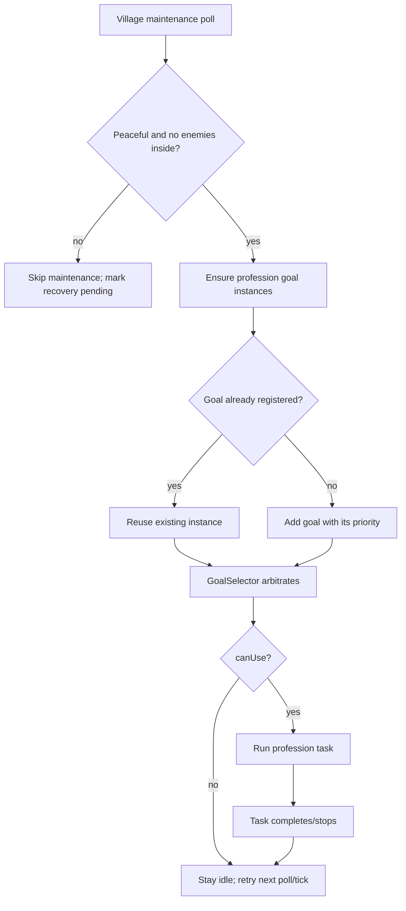
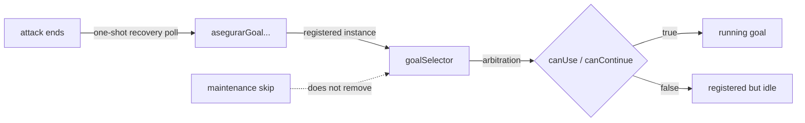

# Village Profession Lifecycle and Recovery

**Maintenance note:** before editing profession recovery, read this document,
`docs/aldea-invariantes.md`, and `docs/CONTINUAR.md`. The critical code paths are
`VillageManager.manageNearby`, `tickVillageLife`, the `asegurarGoal...` methods,
and the `canUse()` implementations in `VillagerFarmGoal`, `VillagerMinerGoal`,
and `VillagerSmithGoal`.

## Normal profession lifecycle



## Attack, maintenance skip, and recovery

```mermaid
sequenceDiagram
    participant V as VillageManager
    participant G as GoalSelector
    participant P as Profession goals
    V->>V: poll every 200 ticks
    alt under attack or enemies inside
        V->>V: mark recovery pending, skip tickVillageLife
        G->>P: canUse may return false (attack/rest/no task)
        P-->>G: not running, still registered
    else attack cleared between polls
        V->>V: next tick sees pending + clear
        V->>V: one-shot tickVillageLife
        V->>P: ensure methods reuse registered instances
        G->>P: canUse re-evaluated; no forced start
        P-->>G: resume if eligible
        V->>V: clear pending
    end
```

## Registration versus execution



## Invariants

1. Ordinary villagers can resume valid profession behavior after an attack ends.
2. A registered goal is not assumed running.
3. A stopped goal can become eligible when blocking conditions clear.
4. GoalSelector arbitration remains the sole movement authority; recovery never
   forces goals to run.
5. Guards retain combat/guard behavior.
6. Recovery must not create duplicate goal instances.
7. A maintenance skip must not silently become permanent ordinary-work loss.
8. Recovery is bounded and idempotent: pending set and one early poll per
   attack-clear transition.
9. Normal idle is not treated as failure.
10. Existing navigation/siege behavior is unchanged.

## Implemented recovery

When maintenance is skipped due to `under_attack` or `enemies_inside`,
`VillageManager` marks that objective index pending. On the next tick after both
conditions clear, before the next 200-tick poll, it runs the normal
`tickVillageLife` once and clears the pending marker.

The normal path calls the existing idempotent `asegurarGoal...` methods, which
reuse registered instances. It does not reset cooldowns, clear routes, force a
goal to start, or duplicate goals. `canUse()` remains authoritative.

## Known limitations

- The new early-poll path is statically verified but not runtime-validated.
- `MAINTENANCE_RECOVERY_PENDING` is process-local and keyed by objective index.
- Recovery can only help if a goal is registered or the ensure method can add it;
  it cannot make a goal with unsatisfied `canUse()` conditions run.
- A real `under_attack` siege has not yet been exercised after this change.

## A5 `recovery` scenario

Invocation uses the existing A5 launcher with `-Scenario recovery -Level <disposable-level>`.

States: BASELINE -> WAITING_FOR_REAL_ATTACK -> OBSERVING_ATTACK ->
WAITING_FOR_REAL_ATTACK_CLEAR -> WAITING_FOR_RECOVERY_POLL ->
WAITING_FOR_PROFESSION_RESUMPTION -> PASS/FAIL/BLOCKED.

It starts only through `VillageManager.start(level, player, 0, center)`, requires
`hayAsedio` and `isVillageUnderAttack` to become true, waits up to 4000 ticks for
the real attack condition to clear, then requires two tracked ordinary villagers
to run profession goals. It logs `[RECOVERY] BASELINE`, `REAL_ATTACK_START`,
`REAL_ATTACK_CLEAR`, and `CHECK`. PASS requires both to resume and no duplicate
profession goal. BLOCKED means siege did not start/clear in the bounded window or
fewer than two eligible villagers were found. Implemented but not yet runtime-validated.
